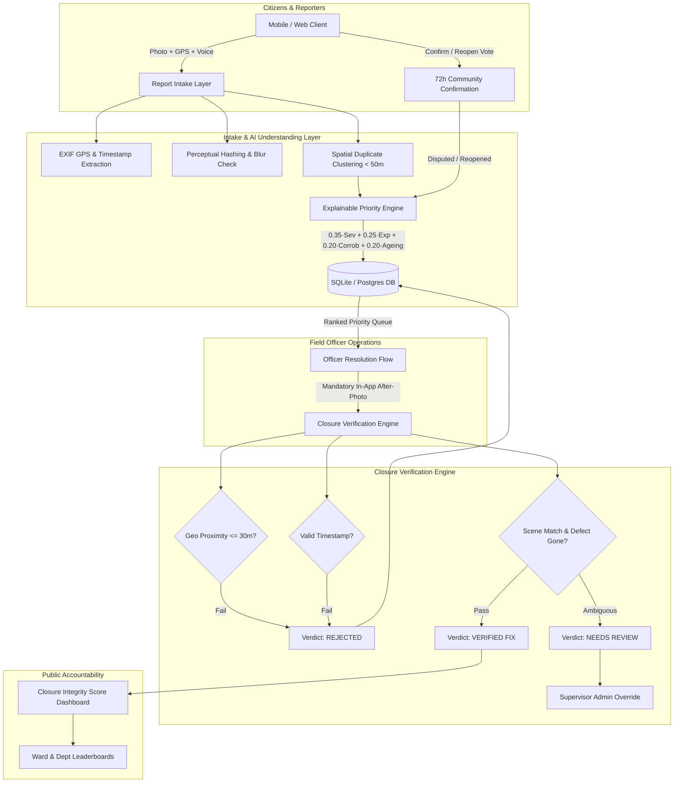

# FixProof – Verified Civic Resolution Platform

> **"Don't just report it. Prove it's fixed."**

[](https://fastapi.tiangolo.com)
[](https://react.dev)
[](https://python.org)
[](https://www.typescriptlang.org)
[](https://tailwindcss.com)
[](https://docs.pytest.org)

FixProof is a verification-first civic technology platform that eliminates false and premature grievance closures. While existing municipal portals (SeeClickFix, FixMyStreet, Swachhata) focus heavily on intake and tracking, complaints are typically closed on the authority's own declaration without independent proof. FixProof rebuilds civic trust through **geotagged after-photo evidence**, an **automated multi-signal verification engine**, a **72-hour community confirmation window**, and **public ward-level Closure Integrity Scores**.

---

## 1. System Architecture



---

## 2. Key Innovations

1. **Closure Verification Engine (Core Centerpiece):**  
   Treats "Resolved" as a claim to be verified rather than an administrative status. Combines:
   - **Geolocation Proximity:** Compares after-photo location to reported coordinates (Haversine distance $\le 30\text{m}$).
   - **Timestamp Freshness:** Rejects stale photos, chronological anomalies, or future timestamps.
   - **Visual Scene & Defect Resolution:** Vision AI (Google Gemini) compares before/after scenes for background alignment (curbs, poles, building facades) and confirms physical defect repair. In Basic Mode, OpenCV ORB feature matching calculates keypoint overlap and transparently flags tickets for supervisor review.
2. **Explainable Priority Score:**  
   Eliminates black-box grievance queues:
   $$\text{Priority} = 0.35 \times \text{Severity} + 0.25 \times \text{Exposure} + 0.20 \times \text{Corroboration} + 0.20 \times \text{Ageing}$$
   Each factor is normalized (0–100). Exposure scores draw from proximity to sensitive institutions (schools, hospitals, transit intersections) via OpenStreetMap Overpass caches.
3. **Closure Integrity Score:**  
   A public metric for each ward and municipal department:
   $$\text{Closure Integrity} = \frac{\text{Verified Closures}}{\text{Claimed Closures}} \times 100\%$$
   Includes reopen rates, SLA breaches, and explicit sample size warnings ($n < 5$).
4. **Honest AI Architecture:**  
   If no API key is provided, the platform functions autonomously in **Basic Heuristic Mode** (using OpenCV ORB, SSIM, and deterministic keyword rules) and explicitly labels every verdict as Basic Mode. When Gemini API is enabled, it transitions to **AI Mode** with detailed confidence metrics and visual reasons.

---

## 3. Technology Stack

- **Frontend:** React 18, Vite 5, TypeScript, Tailwind CSS, Leaflet & React-Leaflet (OpenStreetMap, no API key required), Recharts, i18next (English, தமிழ், हिंदी), Lucide Icons, React Router v6.
- **Backend:** Python 3.11+, FastAPI, SQLAlchemy, Pydantic v2, Pillow, ImageHash, OpenCV (headless), HTTPX, python-jose, passlib (bcrypt), Uvicorn.
- **Database:** SQLite locally (`sqlite:///./fixproof.db`); production-ready with Supabase PostgreSQL via `DATABASE_URL`.
- **Storage:** Local `/uploads` behind an abstracted storage interface (with Supabase Storage support).
- **AI/Vision:** Google Gemini Vision (`gemini-1.5-flash` or configurable model) with OpenCV ORB feature matching fallback.

---

## 4. Quick Start & Local Setup

### Prerequisites
- Node.js v20+ & npm
- Python 3.11+ (or `uv`)
- Git

### Step 1: Clone Repository
```bash
git clone https://github.com/your-username/FixProof.git
cd FixProof
```

### Step 2: Backend Setup
```bash
# Navigate to backend
cd backend

# Create virtual environment (using python venv or uv)
python -m venv .venv
# Windows:
.venv\Scripts\activate
# Linux/macOS:
source .venv/bin/activate

# Install dependencies
pip install -r requirements.txt

# Generate demo photo assets and seed database with 40 Chennai reports
python generate_demo_assets.py
python app/seed.py

# Run automated unit tests
pytest tests/test_fixproof.py -v

# Start FastAPI development server
uvicorn app.main:app --reload --port 8000
```
Backend API will be running at `http://localhost:8000` (Swagger docs at `http://localhost:8000/docs`).

### Step 3: Frontend Setup
In a new terminal window:
```bash
cd frontend

# Install dependencies
npm install

# Start Vite dev server
npm run dev
```
Frontend application will be available at `http://localhost:5173`.

---

## 5. Seeded Demo Accounts & Credentials

The seed script creates 3 demo personas with one-click access on the login page:

| Role | Name | Email | Password | Primary Actions |
|---|---|---|---|---|
| **Citizen** | Ananya Sharma | `citizen@fixproof.org` | `citizen123` | Report defects, upload photos, support issues, vote in 72h community confirmation |
| **Field Officer** | Inspector R. Suresh | `officer@fixproof.org` | `officer123` | Access ranked queue, submit after-photo proof, resolve complaints |
| **Zonal Admin** | Dr. K. Ramanathan | `admin@fixproof.org` | `admin123` | Review "Needs Review" verifications, manual overrides, audit ward integrity |

---

## 6. Live Demo Walkthrough (The "Fake Fix" Scenario)

1. **Intake & Priority:**
   - Sign in as Citizen Ananya.
   - Go to `/report` and upload `demo-assets/before_pothole_1.jpg`.
   - Click **AI Auto-Classify** to inspect category, severity (4/5), and hazard cues.
   - Pinpoint location on the Chennai map and submit.
2. **Officer Queue:**
   - Sign in as Inspector Suresh (`/queue`).
   - Notice complaints ranked by **Explainable Priority Score** and SLA breach badges.
3. **The Fake Fix Caught Live:**
   - Open Ticket #2 (Usman Road Pothole).
   - Click **Resolve with Proof**.
   - Upload after-photo (`demo-assets/after_pothole_1_fake.jpg`).
   - Click the demo button: **`[Fake: Marina Beach 4.2km away]`**.
   - Click **Submit & Trigger Verification**.
   - **Result:** The system flags **REJECTED** with a red badge! It logs a **Geo-proximity FAIL** (4,240m away, threshold 30m) and blocks the fraudulent closure.
4. **Valid Fix & Before/After Slider:**
   - Open Ticket #1 (Lattice Bridge Road).
   - Inspect the **Verified Fix** badge and drag the interactive **Before vs After Split Slider** to inspect the asphalt patch.
5. **Community Re-Verification:**
   - Open Ticket #4 (Broken Streetlight in Anna Nagar).
   - Show how 2 citizen votes stating "No, Still Defective" automatically changed status to **REOPENED**.
6. **Accountability Dashboard:**
   - Navigate to `/accountability` to view the **Closure Integrity Leaderboard** across Chennai wards (Adyar, T. Nagar, Anna Nagar) with small-sample-size warnings.

---

## 7. API Reference Table

| Method | Endpoint | Description | Auth Required |
|---|---|---|---|
| `GET` | `/health` | Service health & AI mode status | Public |
| `POST` | `/api/auth/register` | Register citizen, officer, or admin | Public |
| `POST` | `/api/auth/login` | Login and obtain JWT bearer token | Public |
| `GET` | `/api/auth/me` | Fetch authenticated user profile | Bearer Token |
| `POST` | `/api/reports/analyze` | Vision AI intake defect classification | Public |
| `POST` | `/api/reports/check-duplicates` | Spatial duplicate detection within 50m | Public |
| `POST` | `/api/reports` | Create complaint with photo evidence | Citizen / Any |
| `GET` | `/api/reports` | Filter reports by category, status, ward, bounds | Public |
| `GET` | `/api/reports/{id}` | Full detail, priority breakdown, verifications | Public |
| `POST` | `/api/reports/{id}/support` | Citizen corroboration vote (boosts priority) | Authenticated |
| `POST` | `/api/reports/{id}/confirm` | 72h community confirmation ("fixed"/"not_fixed") | Authenticated |
| `GET` | `/api/officer/queue` | Ranked queue sorted by Priority Score | Officer / Admin |
| `POST` | `/api/officer/reports/{id}/resolve`| Submit after-photo & trigger verification | Officer / Admin |
| `GET` | `/api/verification/pending` | Supervisor queue for "Needs Review" tickets | Admin |
| `POST` | `/api/verification/{id}/override` | Supervisor manual override with notes | Admin |
| `GET` | `/api/accountability/summary` | Overall closure integrity score & stats | Public |
| `GET` | `/api/accountability/wards` | Ward integrity leaderboard | Public |
| `GET` | `/api/accountability/departments` | Departmental performance & SLA breaches | Public |

---

## 8. Honest AI & Privacy Disclosures

- **Privacy Protection:** EXIF GPS and camera hardware tags are extracted for validation and completely stripped from public web images. Citizen names are anonymized to "Citizen" on public views.
- **Honest Mode Labeling:** Basic Mode heuristics (OpenCV ORB feature matching and keyword rules) are never presented as AI. When no Gemini API key is configured, the UI clearly displays **Basic Heuristic Mode**.
- **No Fabricated Benchmarks:** All metrics on the dashboard are computed live from database records. Small sample sizes ($n < 5$) carry explicit cautionary badges.

---

## 9. Limitations & Future Scope

- **Limitations:** Basic heuristic mode without Gemini Vision cannot confirm fine-grained asphalt compaction quality; in-app camera capture is preferred over file uploads to guarantee real-time clock fidelity.
- **Future Scope:** Automated license plate and face blurring (P2), WhatsApp/Telegram reporting bot for low-connectivity regions, municipal GIS integration, and predictive infrastructure wear models.

---

## 10. License & Acknowledgements

Developed for the **Makers Need More (MnM) Hackathon 2026**.  
Licensed under the **MIT License**.
